# Newspaper and mobile UX

Baseline: main at `8c6d694`. Screenshots use the local built site, the same checked-in league data, and Chromium via agent-browser 0.21.4. The local test server disables the real Supabase client. No production access, authenticated interactions, database migration, or deployment is involved.

## Findings and changes

- `js/newspaper.js`: entering Newspaper opened league history rather than the latest verified weekly edition. Entry now opens the latest available final weekly issue. Older weeks have explicit Archive labels; league history remains a separate archive tab. Archive selection has a shareable URL, and entry through the primary Newspaper navigation returns to the latest issue.
- `css/classic.css`: the homepage section index was hidden on phones. A compact native Jump to form now provides Scores, Standings, League leaders, Playoff Race, Recent transactions, Historical notes, Odds, and Weekly newspaper. Selection requires Go, so arrowing through options does not unexpectedly move focus. In-page jumps focus their heading and use the existing measured sticky-header offset. Newspaper opens its existing route because the midweek homepage teaser is intentionally hidden.
- `css/style.css`: weekly article paragraphs rendered at 12px. Scoped overrides in `css/classic.css` use 16px on phones and 15px on tablets, retaining Georgia, existing columns, and dense desktop type. Small source/status text is 11px on phones. Paper stays `#f3ead9` even with the site's dark theme, matching the unchanged PDF/image exporter.
- `css/classic.css`: phone team-name controls were approximately 15px tall. They are now 44px, as are phone edition controls. Table links have a 24px minimum while tables remain compact and scroll within their containers.
- Newspaper entry showed Office navigation followed by a second Newspaper title and edition navigation. The Office header/tabs are hidden only for the Newspaper panel; Rules and polls keep their existing routes. Wire and The Book keep their names, with concise descriptions of their contents.

## Screenshot comparisons

| View | Before | After |
| --- | --- | --- |
| Phone home, 390px | 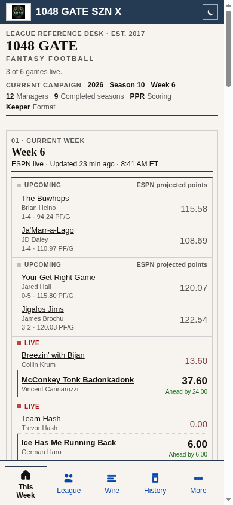 | 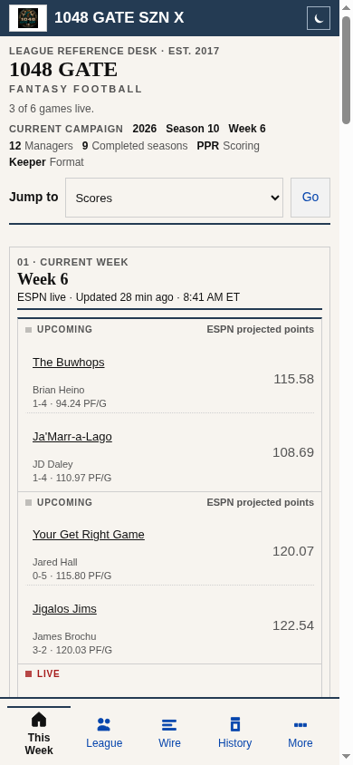 |
| Phone Newspaper entry | 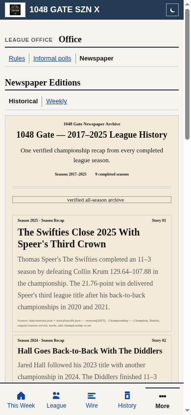 |  |
| Phone weekly issue | 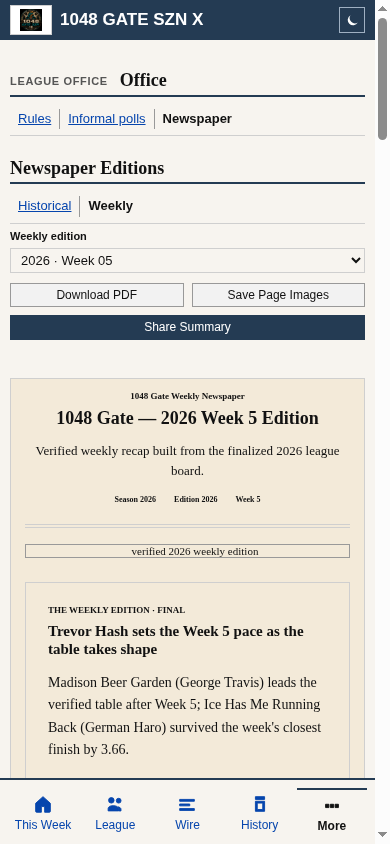 | 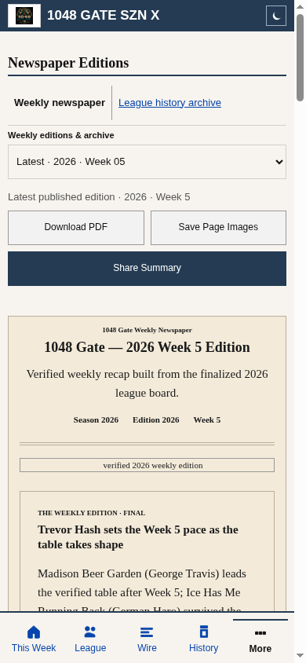 |
| Tablet home, 768px |  | 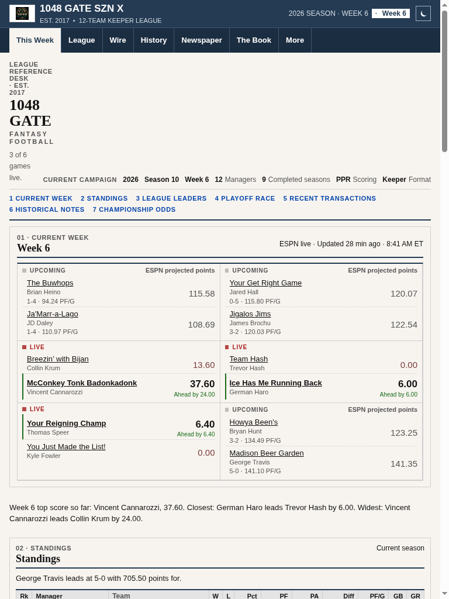 |
| Tablet weekly issue | 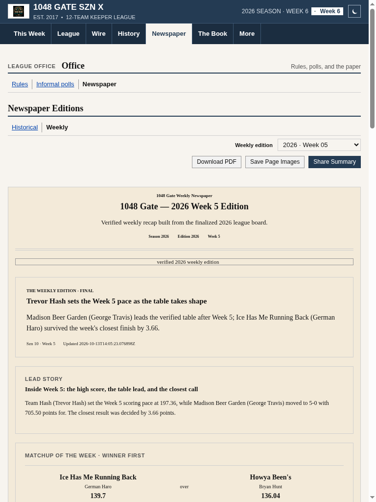 | 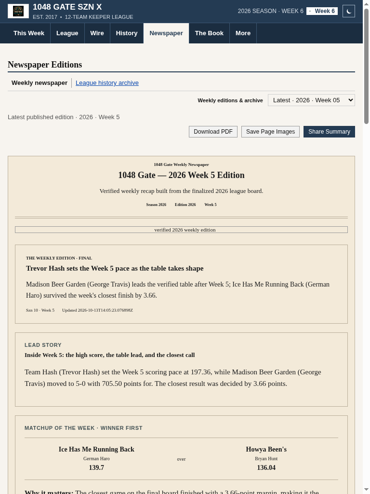 |
| Desktop home, 1440px |  | 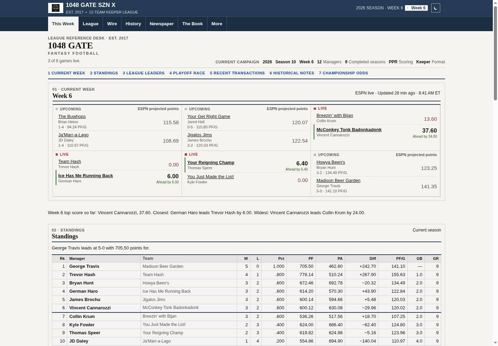 |
| Desktop weekly issue | 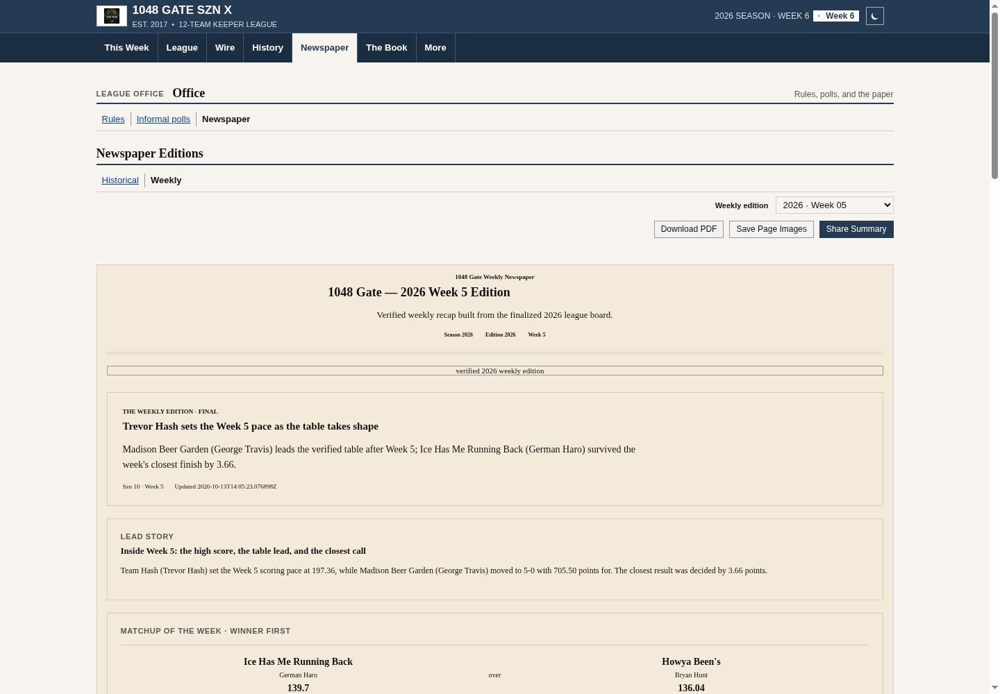 | 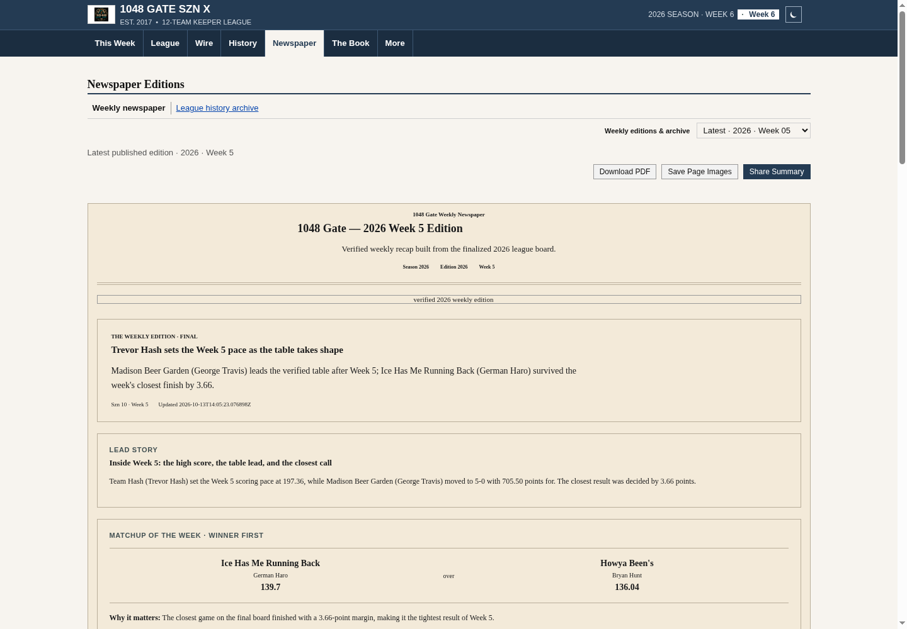 |

## Release boundary

The Phase 3 Supabase migration is already in main, but its production application remains unverified. This work does not apply it or change Supabase permissions. Phase 1–3 behavior, newspaper content, Tuesday 7 AM Eastern/DST lifecycle, generation scripts/workflows, collection, authentication, and production data are unchanged.

## Verification

- `npm test`: passed, including 89 Python tests and the existing Phase 1–3 suites. New regressions exercise the real app's jump submit/focus behavior and newspaper entry, archive selection, URL state, keyboard tabs, unavailable archives, and mismatched edition files.
- Cloudflare verification and Wrangler deployment dry run: passed. No deployment performed.
- agent-browser: local functional checks at 320, 390, 768, and 1440px; before/after captures at 390, 768, and 1440px. Seven section targets focus their heading below the masthead; the Newspaper option opens its route. Native selection keeps focus until Go, and Tab/Space activation works. Arrow keys switch edition tabs with a single tab stop and a named tab panel.
- Newspaper: latest Week 5 is the default while Week 6 is in progress; Week 4 shows Archived weekly edition; history remains available; primary reentry returns to latest. Article contrast measured 14.89:1. Normal and expanded tables, long team names, and paper content have no page overflow in the tested widths. Phone controls are at least 44px; compact table links retain 24px targets.
- Real browser PDF export: three pages, valid `%PDF-1.4`, 1,561,942 bytes; exported paper pixel `[243,234,217,255]` matches browser `#f3ead9`. Existing PDF/export implementation is unchanged.
- Independent Standards review: no findings; documentation attribution clarified. Independent Spec review: no findings. Whitespace checks passed.

Accessibility verification covers DOM semantics, focus, keyboard operation, contrast, and dimensions in Chromium; a manual screen-reader session was not performed.
