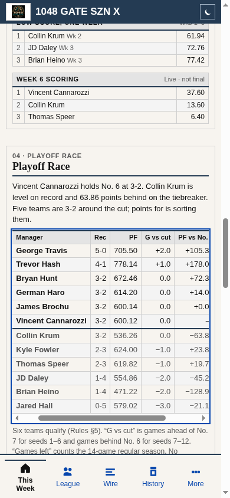
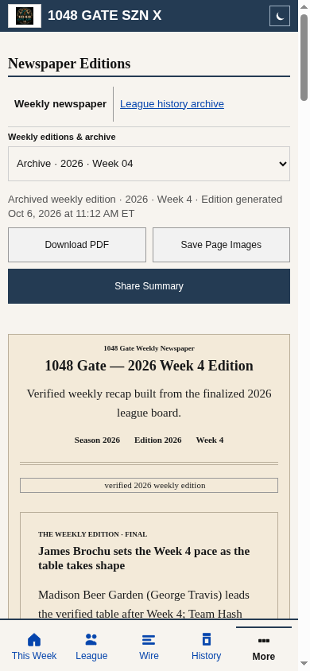

# Phase 6 accessibility and newspaper timestamp follow-ups

October 17, 2026 · Local built-site verification. Base: `d16ddb1` (latest main at task start, including merged PR #105). No production data, generator, workflow, dependency precheck, database, authentication, collection or schedule changes.

## Reproduction and root causes

Before changes, the same local public fixtures used in the audit reproduced axe-core 4.11.1 `scrollable-region-focusable`. At 390px, generic phone CSS made `.desk-race` itself a block scroller: client width 346px, scroll width 457px, tabIndex -1. Adding focus to its parent alone would leave the actual scrolling element inaccessible. [Before evidence](before.json).

The homepage read the newspaper index's `published_at` and displayed “Weekly edition published Oct 13, 2026 at 10:05 AM ET.” Generator source assigns that field from `edition.generated_at`; it is not a successful commit/deployment receipt. The edition JSON supplies the authoritative generation time. A new real-renderer regression first failed when conflicting legacy index metadata caused a December 1999 “published” label instead of the edition's October 2026 generation date.

## Minimal changes

- `js/reference-desk.js`: gives the Playoff Race wrapper `role="region"`, name “Playoff race standings” and `tabindex="0"`.
- `css/classic.css`: keeps its table `display:table` with visible overflow so the wrapper is the single scroller, plus visible keyboard focus. Seven columns, twelve rows, compact spacing and native horizontal scrolling remain. The region is reachable at every viewport, including when all columns fit; no custom key handler or focus trap is added.
- `js/newspaper.js`: homepage and selected-week archive metadata say **Edition generated**, using the edition's `generated_at` and existing Eastern date formatter. Missing/invalid generation times say **Edition generation time unavailable**. No fallback to index `published_at`, browser retrieval or commit dates. Availability labels such as “Latest published edition” still distinguish the latest available issue from archives; they do not claim an exact publication timestamp.
- `scripts/test-newspaper.mjs`: exercises the actual loader/render paths and real freshness formatter for current/archived metadata, deliberately conflicting index publication aliases, and missing/invalid generation times. Existing PDF/export, latest default, archive, tab-key and escaping regressions remain.
- `scripts/visual-qa/playoff-accessibility.cjs`: axe rule, actual table shape, native Tab/ArrowRight/Tab/Shift+Tab, focus contrast and overflow regression. `capture.cjs` runs it in the existing visual matrix. A standalone local runner also covers 320/390/768/1440px in both themes.

The generator and archived files are deliberately unchanged. Legacy `published_at` remains compatible index metadata but is not consumed as a confirmed publication time. No newspaper is regenerated or republished.

## Verification

All checks passed locally. Runtime: Node 22.23.3; browser: installed Chromium 154, agent-browser 0.21.4; workflow-pinned QA packages: Playwright 1.58.2 and axe-core 4.11.1. The hosted Chromium 145 download is proxy-blocked, so the local browser version differs. No hosted or production result is inferred.

| Check | Result |
| --- | --- |
| Before axe rule and new metadata regression | FAIL as expected, on the reported paths |
| Standalone scroll/keyboard regression | PASS: 320, 390, 768, 1440px × light/dark; rule has zero violations/incomplete results |
| Horizontal behavior | Scrolls at 320/390px; columns fit at 768/1440px; no page-wide overflow |
| Focus / semantics | Native Tab reaches and exits, Shift+Tab returns, ArrowRight moves actual overflow; semantic table remains 7 columns / 12 rows |
| Focus contrast | 2px visible outline; 7.77:1 light / 8.59:1 dark against adjacent surfaces |
| agent-browser phone interaction | ArrowRight moved scrollLeft to 40px while “Playoff race standings” retained focus |
| Newspaper labels | Current Week 5 and archived Week 4 use their generation times, including legacy JSON; missing/invalid times stay unavailable |
| Existing visual matrix | PASS: 12 homepage cases / 20 secondary-view checks, zero failures; includes new scroll accessibility checks |
| `npm test` | PASS: all JavaScript checks and 89 Python tests |
| Cloudflare checks / deployment dry run | PASS: 107 public files, 56 hashed assets; no deployment |
| Independent Standards and Spec reviews | No findings; both independently reran the newspaper regression |

[Keyboard/axe measurements](keyboard-after.json). Local test logs remain under `/workspace/reviews/1048-gate/m1l1/`. The existing capture script retains its screenshot, contrast, archive, navigation and failed-refresh assertions.

To run the new standalone test against a local built site, with existing isolated QA dependencies:

```sh
npm run build
QA_NODE_MODULES=/path/to/qa/node_modules \
QA_BASE_URL=http://127.0.0.1:8080 \
node scripts/visual-qa/playoff-accessibility.cjs
```

Start a local static server for `dist/` first. `QA_CHROMIUM_EXECUTABLE` can select an installed local Chromium; the default uses Playwright's installed browser. Requests outside the selected localhost host are aborted. No authentication or live data is required.

## Separate incomplete accessibility results

Re-ran the three relevant rules on home and newspaper in light/dark mode. [Detailed incomplete results](incomplete-after.json). These are **not reported as passes**:

- `aria-prohibited-attr`: `.home-archive-links` and `.edition-status` are generic divs with `aria-label` and no supporting role. Source/DOM inspection confirms the unsupported naming pattern. It is pre-existing and outside the two requested fixes. A separate targeted semantics change should use an appropriate landmark/group or remove redundant labeling, then validate with assistive technology.
- `color-contrast`: four orientation-button arrow spans contain only the decorative `→` character, are `aria-hidden="true"`, and have adjacent text identifying the action. axe leaves them incomplete because their content is non-text. Their decorative semantics were inspected; the automatic result remains incomplete. This is not a blanket contrast or accessibility pass. Manual assistive-technology checks remain advisable.

The newly named Playoff Race region's own focusability and measured focus contrast are verified separately. No manual screen-reader session, Safari/Firefox run, or production verification was performed. Prior proxy access failures mean deployed assets and production availability remain unverified.

## Screenshots and release boundaries

| Phone keyboard focus after scrolling | Archived edition metadata |
| --- | --- |
|  |  |

The Tuesday 7 AM America/New_York candidates, DST gate, single-edition lifecycle, ESPN call count, Phase 1–5 protections and PR #105 prechecks are unchanged. The expected visible changes are a keyboard focus outline and accurate generation metadata; long archive labels wrap without page overflow. No database migration or data repair is required. No merge or deployment is performed.
